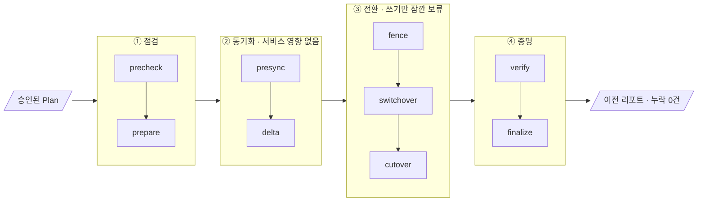
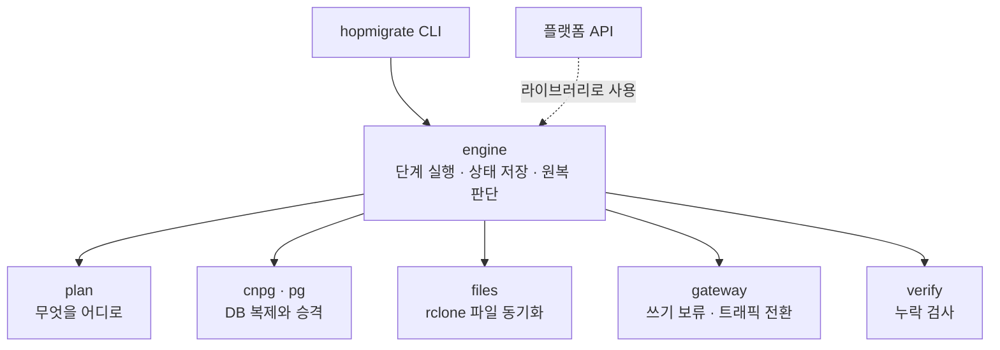
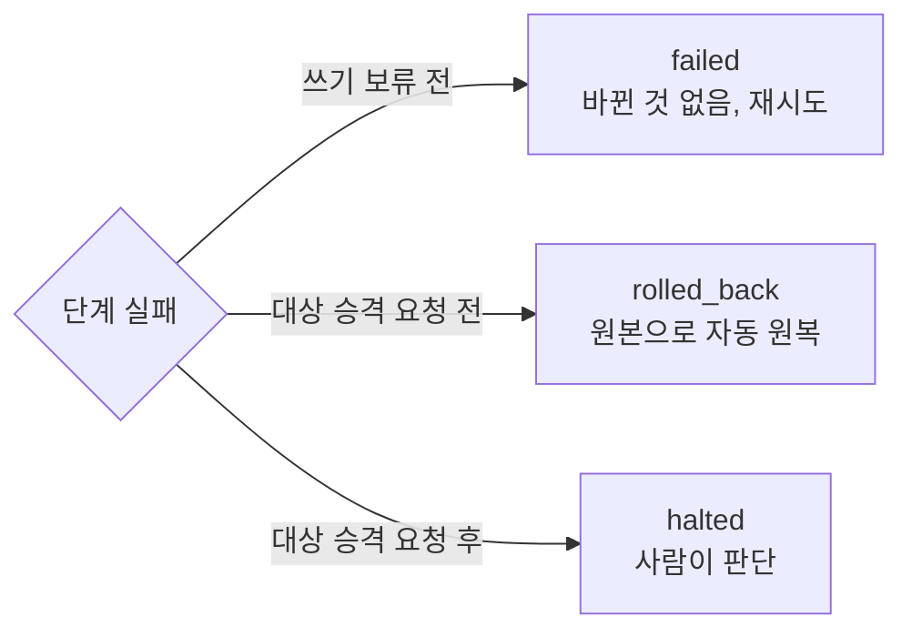

# migration-engine

가동 중인 서비스의 **DB(CNPG)와 파일(S3)** 을 다른 클러스터로 옮기는 HopCharlie의 이전 엔진입니다.
AI가 만든 Plan을 사람이 승인하면, 엔진이 정해진 순서대로만 실행하고 **누락 0건**을 증거로 남깁니다.

## 파이프라인



| 구간 | 하는 일 |
| --- | --- |
| ① 점검 | 원본과 대상 클러스터 상태를 확인하고, 대상에 복제 DB를 만든다 |
| ② 동기화 | DB 복제와 파일 복사를 따라잡는다. 사용자는 계속 원본을 쓴다 |
| ③ 전환 | 게이트웨이가 쓰기를 붙잡은 사이, 양쪽 데이터를 비교하고 대상을 승격한 뒤 트래픽을 넘긴다 |
| ④ 증명 | 원본의 모든 행, k6가 성공한 모든 쓰기, 모든 파일이 대상에 있는지 확인한다 |

## 구조

엔진은 바깥 시스템과 직접 대화하지 않습니다. 모든 외부 작업은 역할별 어댑터를 거칩니다.



## 실패하면



대상 DB가 승격을 요청받은 뒤에는 자동으로 되돌리지 않습니다. 양쪽이 동시에 쓰기를 받는 상황(split-brain)을 막기 위해서입니다.

## 사용법

```bash
go build -o bin/hopmigrate ./cmd/hopmigrate

bin/hopmigrate validate -plan examples/plan.gke-to-eks.json   # Plan 확인
bin/hopmigrate run      -plan examples/plan.gke-to-eks.json   # 전체 실행
bin/hopmigrate run      -plan ... -run <RUN_ID>               # 이어서 실행
bin/hopmigrate step     -plan ... -run <RUN_ID> -step fence   # 한 단계씩 리허설
```

이전이 성공한 뒤 `hopmigrate decommission`으로 옛 앱을 멈추고, 원본에 남은 의존성이 없는지 확인한 뒤 차단하고, 남은 리소스를 근거와 함께 보고합니다 (ADR 0010).

검증 스크립트 (Docker 필요)
- `test/integration/run.sh`: PostgreSQL primary와 standby를 띄워 `pg`, `verify` 통합 테스트
- `test/rehearsal/run.sh`: kind에 CNPG 클러스터 두 개를 띄워 실제 엔진으로 왕복 이전과 원복 리허설 (kind, kubectl 필요)

각 단계의 세부 동작, 다른 팀과의 약속(CNPG 설정, 게이트웨이 API, k6 기록 형식), 알려진 한계는 [docs/details.md](docs/details.md)에 있습니다. 왜 이렇게 만들었는지는 [docs/adr](docs/adr)에 있습니다.
