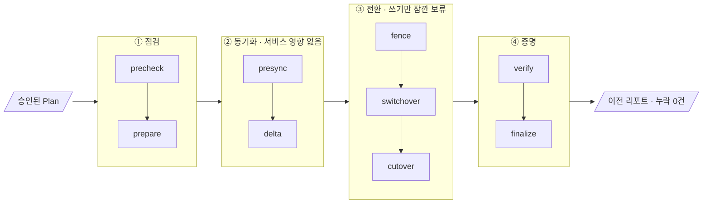
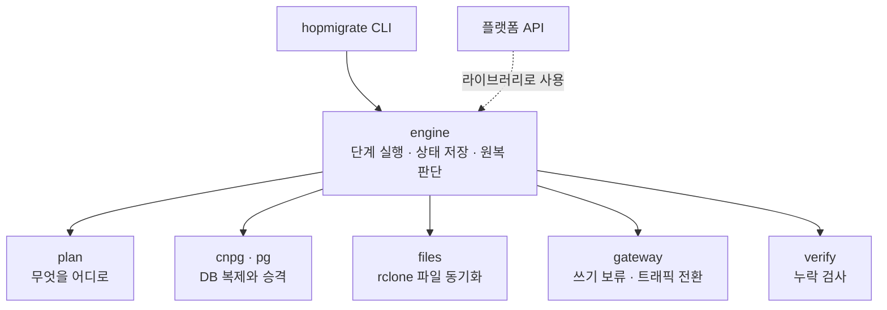
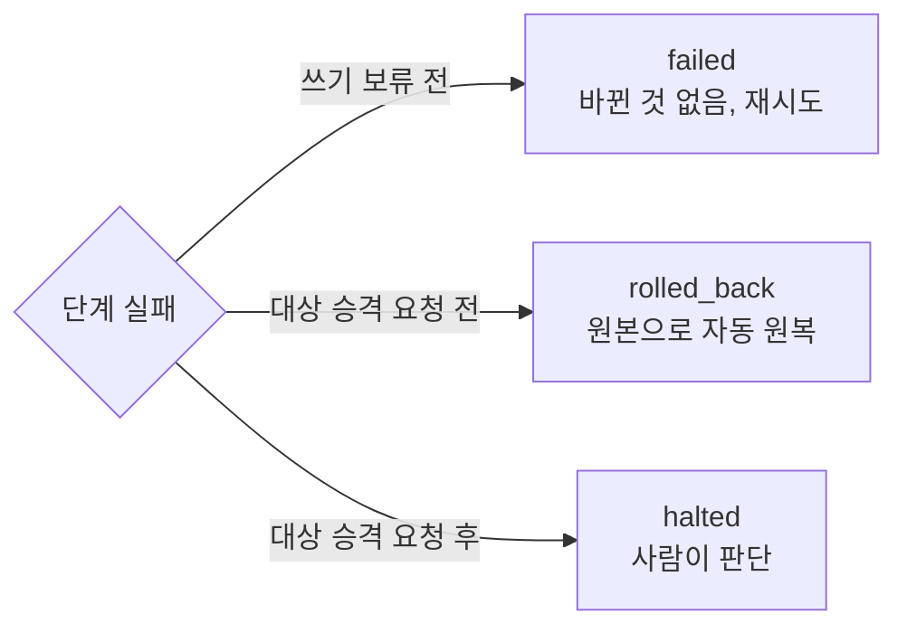

# migration-engine

### 롤백의 쓰기 보존 범위

정상 복귀는 새 primary가 살아 있고 마지막 WAL을 전달할 수 있을 때 역방향 이전으로 수행합니다. 교차 환경 복제는 비동기이므로 primary 환경/저장소 유실에 대한 RPO=0은 지원하지 않습니다. gateway 밖 writer는 중지·차단하고 진행 중 트랜잭션 종료를 확인해야 합니다. [계약과 제외 범위](docs/adr/0015-rollback-acknowledged-writes.md)를 참고하세요.

`verify.writtenRecords` JSONL은 기존 `table`/`pk` 존재 검사 외에 최종 UPDATE 상태와 DELETE를 지원합니다. writer를 멈춘 뒤 키마다 마지막 성공 상태 하나를 기록하세요. `expected`는 전체 행 JSON이고 `absent`와 함께 쓸 수 없습니다. 결과 불명 요청은 별도 기록합니다.

```jsonl
{"table":"public.orders","pk":"1","expected":{"id":1,"total":200,"note":"updated"}}
{"table":"public.orders","pk":"2","absent":true}
```

기존 `test/rehearsal/run.sh`에 전환 후 트랜잭션의 INSERT/UPDATE/DELETE, replica replay 지연, 역방향 이전 후 최종 상태 비교를 포함했습니다. runner의 독립 기록은 `$work/acknowledged*`에 남습니다. PK는 행 중복을 막지만 외부 부작용의 exactly-once까지 증명하지 않습니다. 안전 단계 실행 중 재시작은 자동 재실행 대신 halt하며, 승격 중 중단만 기존 `resume`의 실상태 검증으로 재개할 수 있습니다.

가동 중인 서비스의 **DB(CNPG)와 파일(S3)** 을 다른 클러스터로 옮기는 HopCharlie의 이전 엔진입니다.
AI가 만든 Plan을 사람이 승인하면, 엔진이 정해진 순서대로만 실행하고 **누락 0건**을 증거로 남깁니다.

## 파이프라인



| 구간 | 하는 일 |
| --- | --- |
| ① 점검 | 원본과 대상 클러스터 상태를 확인하고, 대상에 복제 DB를 만든다 |
| ② 동기화 | DB 복제와 파일 복사를 따라잡는다. 사용자는 계속 원본을 쓴다 |
| ③ 전환 | 게이트웨이가 쓰기를 붙잡은 사이, 양쪽 데이터를 비교하고 대상을 승격한 뒤 트래픽을 넘긴다 |
| ④ 증명 | 원본의 모든 행, k6가 성공한 모든 쓰기, 모든 파일이 대상에 있는지 확인한다 |

## 구조

엔진은 바깥 시스템과 직접 대화하지 않습니다. 모든 외부 작업은 역할별 어댑터를 거칩니다.



## 실패하면



대상 DB가 승격을 요청받은 뒤에는 자동으로 되돌리지 않습니다. 양쪽이 동시에 쓰기를 받는 상황(split-brain)을 막기 위해서입니다.

## 사용법

```bash
go build -o bin/hopmigrate ./cmd/hopmigrate

bin/hopmigrate validate -plan examples/plan.gke-to-eks.json   # Plan 확인
bin/hopmigrate run      -plan examples/plan.gke-to-eks.json   # 전체 실행
bin/hopmigrate run      -plan ... -run <RUN_ID>               # 이어서 실행
bin/hopmigrate step     -plan ... -run <RUN_ID> -step fence   # 한 단계씩 리허설
```

이전이 성공한 뒤 `hopmigrate decommission`으로 옛 앱을 멈추고, 원본에 남은 의존성이 없는지 확인한 뒤 차단하고, 남은 리소스를 근거와 함께 보고합니다 (ADR 0010).

검증 스크립트 (Docker 필요)
- `test/integration/run.sh`: PostgreSQL primary와 standby를 띄워 `pg`, `verify` 통합 테스트
- `test/rehearsal/run.sh`: kind에 CNPG 클러스터 두 개를 띄워 실제 엔진으로 왕복 이전과 원복 리허설 (kind, kubectl 필요)

각 단계의 세부 동작, 다른 팀과의 약속(CNPG 설정, 게이트웨이 API, k6 기록 형식), 알려진 한계는 [docs/details.md](docs/details.md)에 있습니다. 왜 이렇게 만들었는지는 [docs/adr](docs/adr)에 있습니다.

## CI와 main 머지 조건

모든 PR은 `ci` workflow의 `go`(전체 race·vet·build·PostgreSQL 통합)와 `cnpg-write-fence`(실제 kind CNPG fence·admission)를 통과해야 합니다. main은 최신 변경과 동기화한 PR만 받으며 관리자에게도 같은 조건을 적용합니다. main force push·삭제와 PR bypass는 허용하지 않습니다.

실제 적용 설정과 확인 명령은 [ADR 0023](docs/adr/0023-require-existing-ci-before-main-merge.md), 정확한 설정 요청은 [main.json](.github/branch-protection/main.json)에 기록했습니다. 파일을 바꾸는 것만으로 GitHub 설정이 자동 변경되지는 않습니다.
